# Cisplatin "chemo brain" at single-cell resolution (GSE216146)

Re-analysis of the mouse brain single-cell RNA-seq dataset
[GSE216146](https://www.ncbi.nlm.nih.gov/geo/query/acc.cgi?acc=GSE216146) with Scanpy, comparing
**cisplatin-treated** and **control (PBS)** brains. Starting from the GEO count matrix, the analysis covers quality
control, batch integration, cell-type annotation, composition, pseudobulk differential expression, gene set
enrichment (including the SenMayo senescence set), per-cell senescence scores, cell-cell communication,
pseudotime and RNA velocity of oligodendrocyte maturation.

The analysis is a set of numbered Jupyter notebooks that run top to bottom. All parameters are in
[`config.yaml`](config.yaml), and shared functions are in [`scripts/sc_utils.py`](scripts/sc_utils.py).

> **Scope.** Each condition has three mice, and the two sequencing batches differ in quality. Every test uses the
> sample, not the cell, as the replicate and includes the batch as a covariate. With 3 vs 3, the results are
> **exploratory**: few of them pass multiple-testing correction, and the text below reports nominal p-values when
> FDR is not reached.

## Dataset

GEO series GSE216146 ("Gamma entrainment using sensory stimuli alleviate chemo brain pathology and cognitive
impairment induced by chemotherapy agents"; raw reads: SRA `SRP403578` / BioProject `PRJNA892229`). The series has
12 biosamples. Their `pathology` code combines treatment (`P` = PBS, `C` = cisplatin) and stimulation (`N` = none,
`S` = gamma sensory stimulation). This analysis uses only the **unstimulated** samples:

| Biosample | Condition | Batch | Cells after QC |
|---|---|---|---|
| D20-6407 | Control (PN) | D20 | 988 |
| D21-2746 | Control (PN) | D21 | 2,384 |
| D21-2747 | Control (PN) | D21 | 1,650 |
| D20-6409 | Cisplatin (CN) | D20 | 1,591 |
| D21-2750 | Cisplatin (CN) | D21 | 2,312 |
| D21-2751 | Cisplatin (CN) | D21 | 907 |

**Inputs.** The analysis starts from the GEO count files: `GSE216146_expression_matrix.mtx.gz` (integer UMI counts,
cells x genes), `GSE216146_genes.tsv.gz` and `GSE216146_cell_metadata.tsv.gz`. These cells were already filtered by
the authors, including doublet removal. The authors' processed object (`GSE216146_chemo_brain.h5ad.gz`) is used for
one thing only: its velocyto `spliced` / `unspliced` layers, read for the oligodendrocyte lineage in the RNA velocity
step. Raw data are not versioned; they are read from the folder in the `DATA` environment variable.

## Workflow

| Notebook | What it does | Main methods |
|---|---|---|
| [`01_qc`](notebooks/01_qc.ipynb) | Build the AnnData from the counts files and run per-sample QC: mitochondrial cut at median + 3 MAD per sample, gene and ribosomal filters, normalization | Scanpy |
| [`02_integration_clustering`](notebooks/02_integration_clustering.ipynb) | Highly variable genes, PCA, batch correction per biosample, UMAP, Leiden clustering at 3 resolutions | Harmony, Leiden |
| [`03_annotation`](notebooks/03_annotation.ipynb) | Cell types per cluster from marker genes and CellTypist (adult whole-brain model), cross-checked against the authors' labels; ambient RNA check | CellTypist `Mouse_Whole_Brain` |
| [`04_composition`](notebooks/04_composition.ipynb) | Cell-type proportions per sample, chemotherapy vs control, with and without choroid plexus | propeller-style test (arcsin-sqrt, OLS `~ batch + condition`) |
| [`05_pseudobulk_de`](notebooks/05_pseudobulk_de.ipynb) | Pseudobulk differential expression per cell type; ambient, contamination, stress and technical genes flagged; volcano plots | PyDESeq2 `~ batch + condition` |
| [`06_enrichment`](notebooks/06_enrichment.ipynb) | Preranked GSEA per cell type on the DE statistic | gseapy; GO BP 2025, KEGG, MSigDB Hallmark, **SenMayo** |
| [`07_senescence`](notebooks/07_senescence.ipynb) | Per-cell senescence scores within each cell type, tested per sample | SenePy (universal + matched signatures), SenMayo score |
| [`08_cell_communication`](notebooks/08_cell_communication.ipynb) | Ligand-receptor inference: consensus per sample, CellChat per condition, changes derived from the DE results | LIANA+ (CellPhoneDB, Connectome, log2FC, NATMI, SingleCellSignalR, CellChat) |
| [`09_pseudotime`](notebooks/09_pseudotime.ipynb) | Trajectory from newly formed to mature oligodendrocytes; exports the lineage for RNA velocity | PAGA, diffusion pseudotime |
| [`10_velocity`](notebooks/10_velocity.ipynb) | RNA velocity of the same lineage as an independent check of the 09 direction (separate environment) | scVelo (stochastic model) |

Each notebook reads the checkpoint of an earlier step from `results/` and writes its own. Every key figure is saved
to `results/plots/`, and a selection is copied to [`figures/`](figures) by
[`scripts/export_figures.py`](scripts/export_figures.py).

## Results

### Quality control and annotation

The D20 batch is of lower quality, with a higher mitochondrial fraction and many low-complexity cells. A fixed 20 %
mitochondrial cut would have removed about a third of its cells, so the cut is set per sample at median + 3 MAD.
After QC, 9,832 cells and 20,009 genes remain.

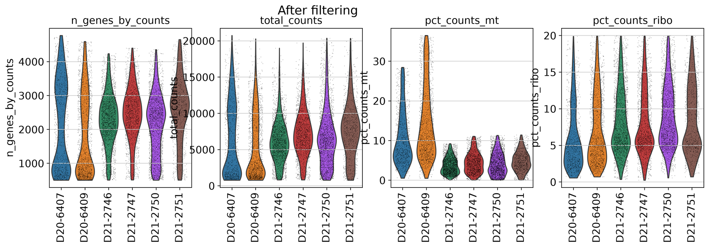

The tissue is hippocampus plus choroid plexus: the data contain dentate gyrus granule neurons, DG neuroblasts and
Cajal-Retzius cells. Twelve cell types were annotated. Every cluster matches the authors' labels (agreement >= 0.9,
pericyte/fibroblast 0.77). A small low-quality microglia cluster (104 cells) is labelled and excluded from the
downstream steps.

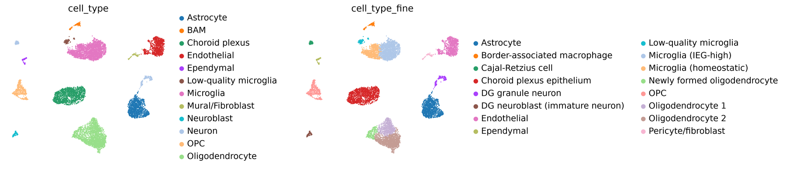
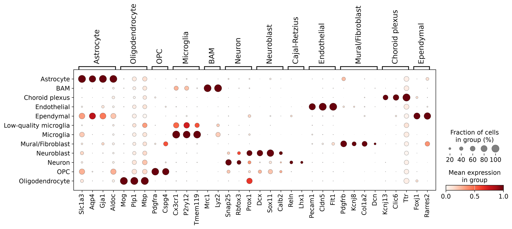

Choroid plexus transcripts (*Ttr*) are detected in about 55 % of all cells, and more in the cisplatin samples. This is
ambient RNA, so these genes are flagged in the differential expression rather than reported as hits.

### Composition

No cell type passes FDR < 0.1. **Neuroblasts** are lower in all three cisplatin samples than in every control
(log2 ratio -1.7 to -1.9, p = 0.03). This fits reduced hippocampal neurogenesis, although dissection may contribute.
An apparent decrease of microglia is an artefact of the large choroid plexus fraction in one sample: it disappears
once choroid plexus is removed and the proportions are renormalized.

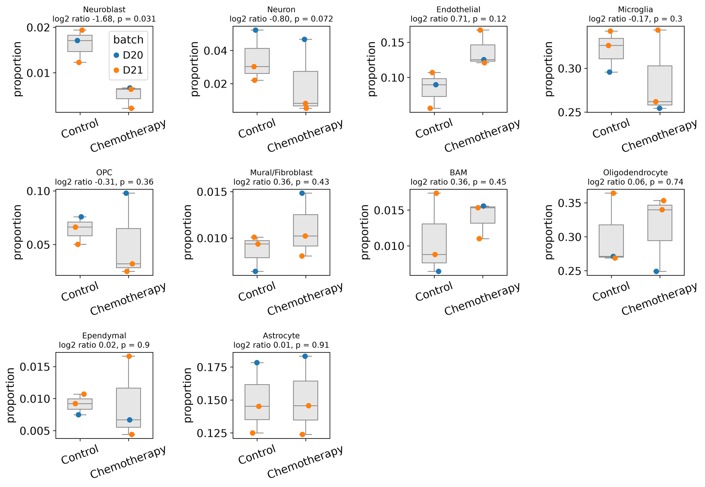

### Differential expression and enrichment

Pseudobulk DESeq2 with `~ batch + condition` was run on 9 cell types. Genes are counted as clean hits only if they
are not flagged; the flags cover ambient RNA, genes >= 20x higher in another cell type, immediate-early stress genes,
and rRNA-overlap artefacts. Clean hits (padj < 0.05, |log2FC| >= 0.5): oligodendrocytes 194, microglia 80,
endothelium 35, astrocytes 27, OPC 14.

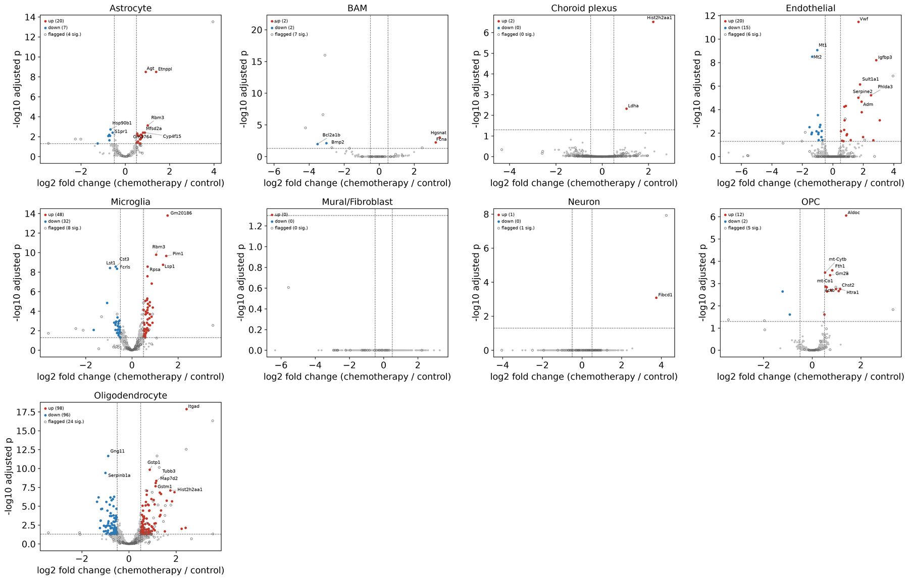

- **Endothelium** shows the clearest response to cisplatin. The p53 target *Phlda3* and the activation genes *Vwf*,
  *Vcam1*, *Igfbp3* and *Adm* go up. In GSEA, the **SenMayo senescence set is enriched in endothelial cells**
  (NES 1.84, p = 0.002; leading edge *Igfbp3*, *Serpine2*, *Icam1*, *Fas*, *Cxcl1*, *Edn1*).
- **Hallmarks** (FDR < 0.05): the p53 pathway goes up in endothelium, microglia and oligodendrocytes. Microglia also
  show an inflammatory profile: interferon, TNF/NF-kB, IL-6/JAK/STAT3 and complement go up.

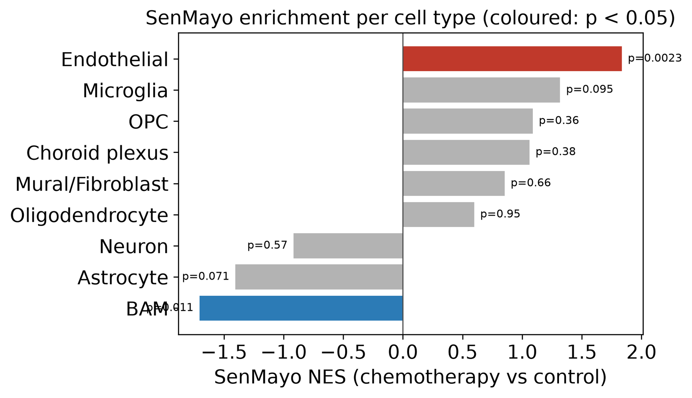
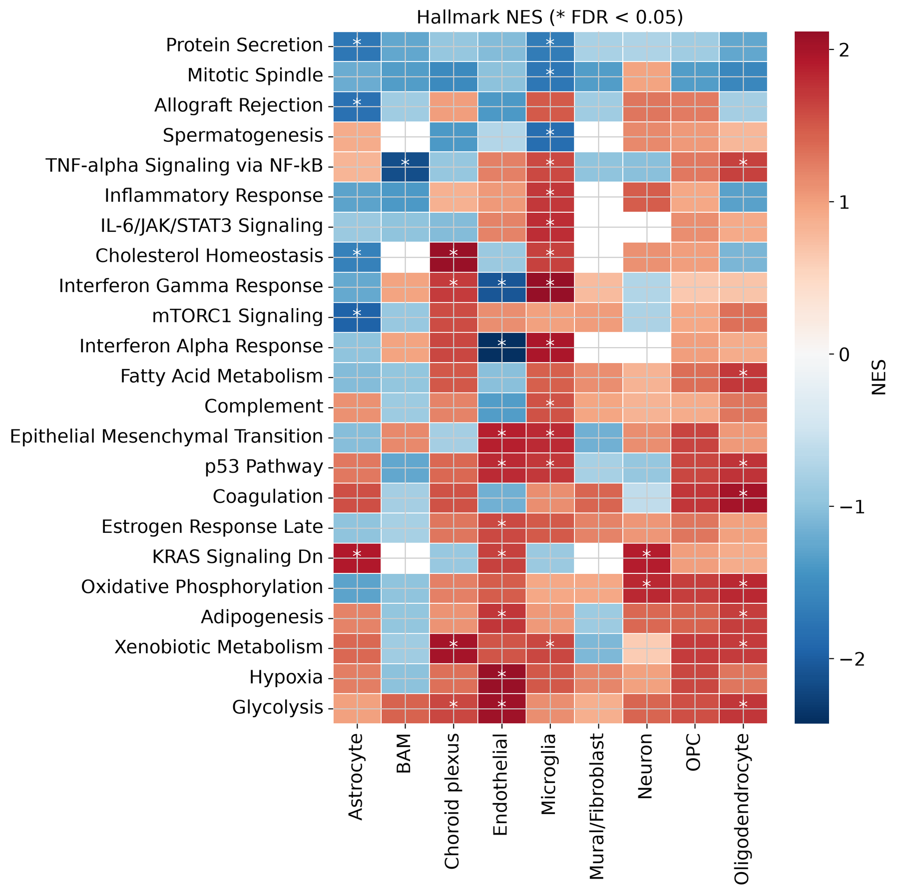

### Senescence scores

Per-cell scores were computed within each cell type. With SenMayo, the fraction of high-scoring endothelial cells
rises from 5 % to 13.5 % with cisplatin (p = 0.014). This agrees with the GSEA result. With the SenePy universal
signature, high-scoring microglia rise from 6.7 % to 14.4 % (p = 0.026). The three scores agree poorly within cell
types, because signatures built in other tissues and ages transfer badly to the brain. The SenePy results should
therefore be read as exploratory.

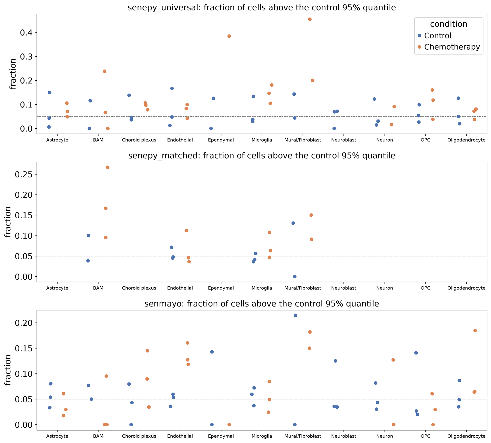

### Cell-cell communication

Interaction changes were derived from the pseudobulk DE. In 39 "concordant" interactions, the ligand (in the sender)
and the receptor (in the receiver) change in the same direction. These interactions show three patterns:
- **Endothelium to microglia, up:** *Vwf* and *Serpine2* -> *Lrp1*, *Adm* -> *Gpr84*.
- **Border-associated macrophages to microglia and OPC, down:** *Bmp2* -> *Bmpr1b/Bmpr2*.
- **Integrin and extracellular-matrix signalling to oligodendrocytes, down:** *Vcam1*, *Col4a1* and *Timp2* ->
  *Itgb1* complexes.

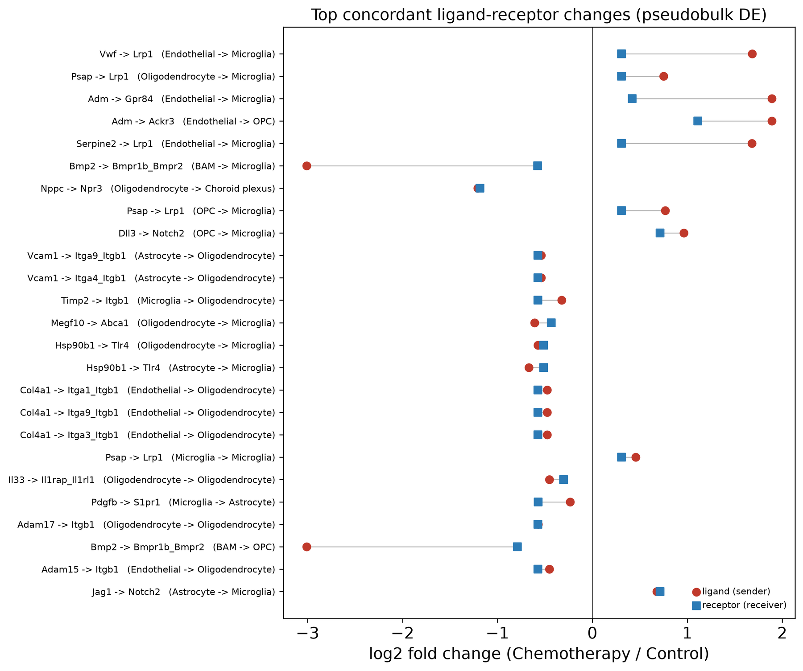

### Oligodendrocyte maturation: pseudotime and RNA velocity

OPC are disconnected from oligodendrocytes in the neighbour graph: no committed OPC were captured. The trajectory is
therefore analysed from **newly formed to mature oligodendrocytes**. Its order is consistent with known markers:
*Enpp6* decreases and *Opalin* increases along pseudotime. Cisplatin does not change the median pseudotime, but it
shifts the balance between the two mature states: Oligodendrocyte 1 goes from 24 % to 35 % of the lineage
(p = 0.02, FDR 0.056).

RNA velocity (scVelo stochastic model) gives an independent ordering:
- It agrees with the diffusion pseudotime (Spearman 0.63, same in both batches), and it places Oligodendrocyte 2 as
  the end state.
- Its inferred origin sits in Oligodendrocyte 1 rather than in the newly formed cells.
- The dynamical model reverses the direction, a known failure mode in near-steady-state populations, so it is kept
  only as a check.

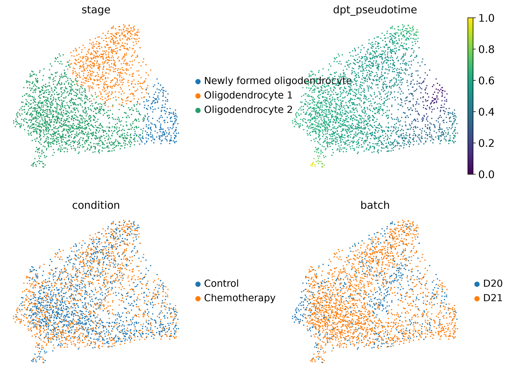
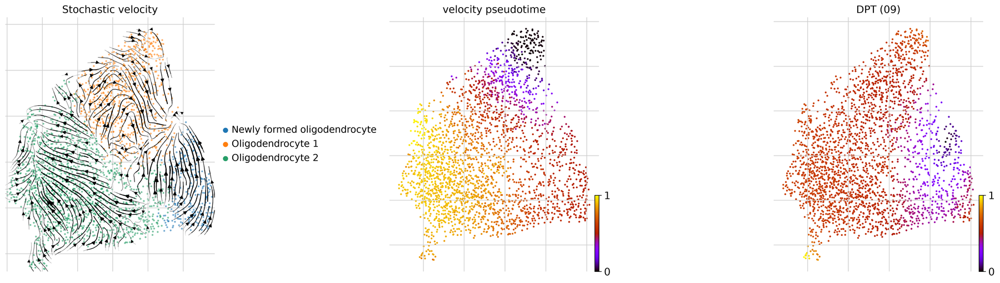

## Limitations

- **Replicates and batch:** n = 3 per condition, with batch D20 of lower quality (one control and one cisplatin
  sample). All tests are at the sample level with batch as a covariate, and they are exploratory.
- **Ambient RNA:** it cannot be removed from these counts, because no empty droplets are available. Ambient,
  cross-cell-type and technical genes are flagged instead.
- **Dissection:** it varies between samples. For example, choroid plexus is 40 % of the cells in D21-2750, and two
  cisplatin samples have very few neurons. This affects composition results.
- **Velocity data:** the RNA velocity layers come from the authors' own quantification, not from re-processing the
  reads. The raw FASTQ (~440 GB for the six samples) was not re-quantified.

## How to run

```bash
# main environment (repository root)
conda env create -f ../environment.yaml
conda activate single-cell
python -m ipykernel install --user --name single-cell

# separate environment for 10_velocity only (scVelo 0.3 does not work with pandas 3 / numpy 2.5)
conda env create -f envs/velocity.yaml
conda activate velocity && python -m ipykernel install --user --name velocity

# GEO files in $DATA (see config.yaml, paths)
export DATA=/path/to/geo/files
jupyter lab   # from single_cell_notebook/; run the notebooks in order, 10_velocity with the `velocity` kernel
```

Headless runs: `jupyter nbconvert --to notebook --execute --inplace --ExecutePreprocessor.kernel_name=single-cell
notebooks/01_qc.ipynb`. On an 8-core, 15 GB machine the full chain takes about 15 minutes.

## Layout

```
single_cell_notebook/
├── config.yaml            parameters for all notebooks (paths, samples, thresholds, models)
├── notebooks/             01_qc ... 10_velocity
├── scripts/sc_utils.py    shared functions (loading, QC, pseudobulk, tests, plots, gene sets)
├── scripts/export_figures.py
├── resources/             small tracked gene sets (SenMayo, with source)
├── envs/velocity.yaml     environment for 10_velocity
├── figures/               key figures shown above
└── results/               checkpoints, tables and plots (generated, not versioned)
```

## References

- Wolf, Angerer & Theis (2018). SCANPY. *Genome Biology* 19:15.
- Korsunsky et al. (2019). Harmony. *Nature Methods* 16:1289–1296.
- Domínguez Conde et al. (2022). CellTypist. *Science* 376:eabl5197. Model `Mouse_Whole_Brain`, based on
  Yao et al. (2023), *Nature* 624:317–332.
- Phipson et al. (2022). propeller. *Bioinformatics* 38:4720–4726.
- Muzellec et al. (2023). PyDESeq2. *Bioinformatics* 39:btad547.
- Fang et al. (2023). GSEApy. *Bioinformatics* 39:btac757.
- Saul et al. (2022). SenMayo. *Nature Communications* 13:4827.
- SenePy, M. Sanborn: <https://github.com/mousepixels/senepy>.
- Dimitrov et al. (2024). LIANA+. *Nature Cell Biology* 26:1613–1622.
- Bergen et al. (2020). scVelo. *Nature Biotechnology* 38:1408–1414.
